# Computación Ubicua · Arduino

Laboratorios, robot MultiBot y proyecto final de la materia **Computación Ubicua** (Ingeniería de Software, Universidad Cooperativa de Colombia, 2025): sensores, actuadores, control de motores, radiofrecuencia y una **cerradura inteligente con RFID**.


| Contenido | |
| :-- | :-- |
| [Proyecto final: cerradura con RFID](#proyecto-final-cerradura-inteligente-con-rfid) | Lector RC522, tarjetas autorizadas, LEDs de estado y cerradura con transistor |
| [Laboratorios 1 a 7](#laboratorios) | LED, pulsador, PWM, temperatura, humedad, LCD y ultrasonido, con simulador en línea |
| [MultiBot](#multibot) | Carro de dos motores con puente H y control por radio |

---

## Proyecto final: cerradura inteligente con RFID

Reemplaza la llave por una tarjeta o llavero RFID: al acercarla al lector, el Arduino compara su identificador (UID) con una lista de tarjetas autorizadas y, si coincide, acciona la cerradura durante 5 segundos.

<a href="https://www.youtube.com/watch?v=429Tt-C3h7E"></a>

**[Ver el video del montaje y funcionamiento](https://www.youtube.com/watch?v=429Tt-C3h7E)** · [Código](proyecto-final-rfid/cerradura-rfid/cerradura-rfid.ino) · [Presentación](proyecto-final-rfid/presentacion.pptx)

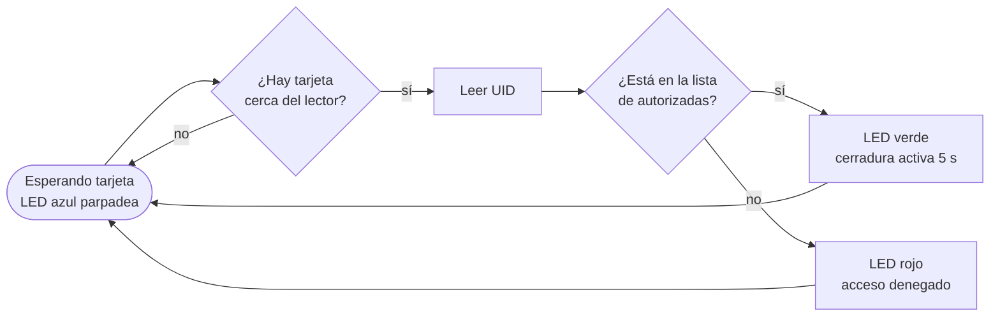

**Cómo funciona**

- **Lectura RFID:** el módulo RC522 se comunica con el Arduino por SPI y entrega el UID de 4 bytes de la tarjeta.
- **Autorización:** el UID se compara byte a byte con la lista `authorizedUIDs`. Agregar una tarjeta es agregar una línea.
- **Sin bloquear el programa:** el parpadeo del LED y el tiempo de la cerradura se controlan con `millis()` en lugar de `delay()`, así el lector sigue atento mientras la cerradura está abierta.
- **Potencia:** el Arduino no alimenta la cerradura directamente. Un transistor de potencia (TIP122) la activa con una señal PWM desde el pin 6.
- **Diagnóstico:** cada lectura se registra en el monitor serial con el UID y el resultado.

**Componentes:** Arduino UNO R3, lector RFID RC522 con tarjeta y llavero, cerradura (motor DC / solenoide), transistor TIP122, 3 LEDs (verde, rojo y azul), resistencias, protoboard y fuente DC.

---

## Laboratorios

Cada carpeta tiene el código listo para abrir en el IDE de Arduino y una foto del montaje. Los simuladores funcionan en el navegador, sin hardware.

| # | Laboratorio | Qué aprendí | Simulador | Montaje |
| :-: | :-- | :-- | :-- | :-: |
| 1 | [Parpadeo de un LED](laboratorios/01-parpadeo-led) | Salidas digitales y tiempos con `delay()` | [Tinkercad](https://www.tinkercad.com/things/cYyP2rRWnsI-laboratorio-1) | 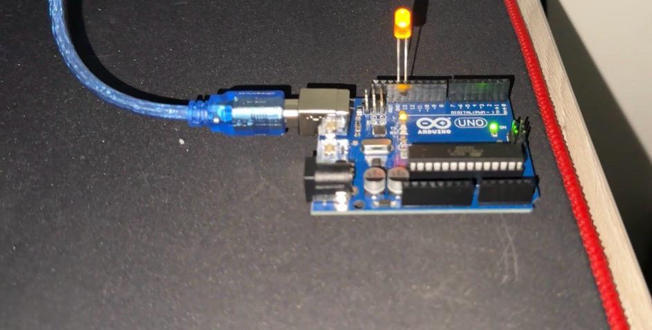 |
| 2 | [Pulsador y LED](laboratorios/02-pulsador-y-led) | Entradas digitales y antirrebote: encender al presionar, interruptor y temporizador de 5 s | [P1](https://www.tinkercad.com/things/fTjgmyWP85D-laboratorio-2-programa-1-) · [P2](https://www.tinkercad.com/things/eUZwfgAHyme-laboratorio-2-programa-2) · [P3](https://www.tinkercad.com/things/fdRvRInnSUR-laboratorio-2-programa-3) | 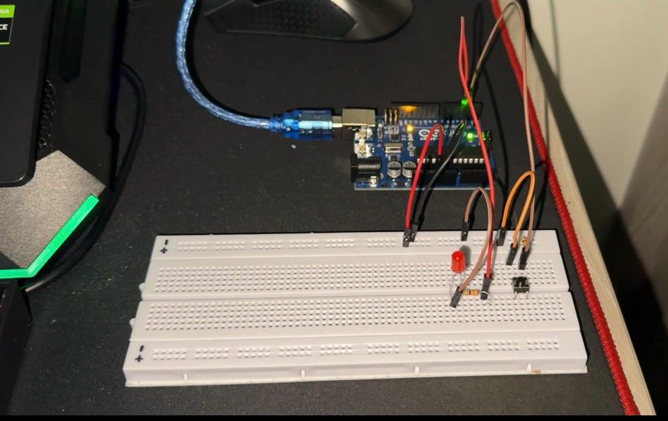 |
| 3 | [Brillo con potenciómetro](laboratorios/03-brillo-con-potenciometro) | Entrada analógica y salida PWM | [Tinkercad](https://www.tinkercad.com/things/1IsWS8x6Smr-laboratorio-3-programa-2-) | 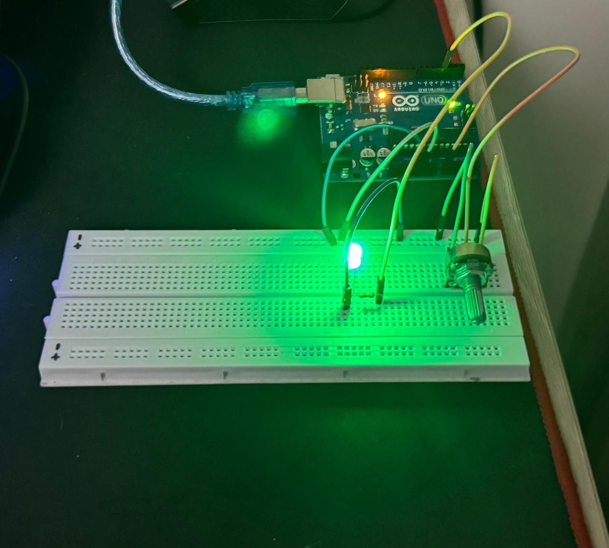 |
| 4 | [Temperatura con LM35](laboratorios/04-temperatura-lm35) | Conversión de voltaje a °C y promedio de 5 lecturas para reducir ruido | [P1](https://www.tinkercad.com/things/dye3I4zzyhT-laboratorio-4-programa-1) · [P2](https://www.tinkercad.com/things/40ldhTSLQZr-laboratorio-4-programa-2-) | 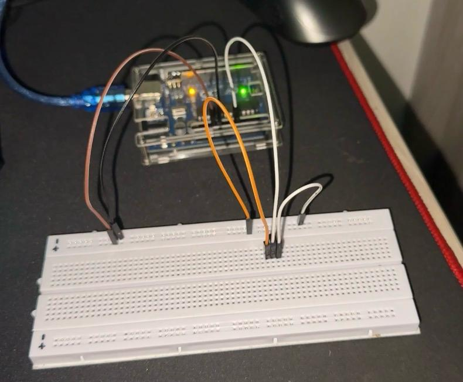 |
| 5 | [Temperatura y humedad con DHT](laboratorios/05-temperatura-y-humedad-dht) | Sensores digitales con librería (DHT11 y DHT22) | [Wokwi](https://wokwi.com/projects/443383524071750657) | |
| 6 | [Reto: DHT + LM35 + LCD](laboratorios/06-reto-dht-lm35-lcd) | Dos sensores a la vez, pantalla LCD 16×2, manejo de errores y lecturas cada 2,5 s con `millis()` | | 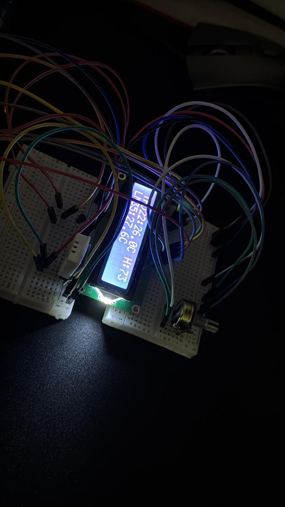 |
| 7 | [Sensor ultrasónico HC-SR04](laboratorios/07-sensor-ultrasonico) | Medir distancia con `pulseIn()` y alarma con LED a menos de 20 cm | [P1](https://www.tinkercad.com/things/kaRqVSSGK9M-laboratorio-5-programa-1-) · [P2](https://www.tinkercad.com/things/6CXB2UmhYTK-laboratorio-5-programa-2) | 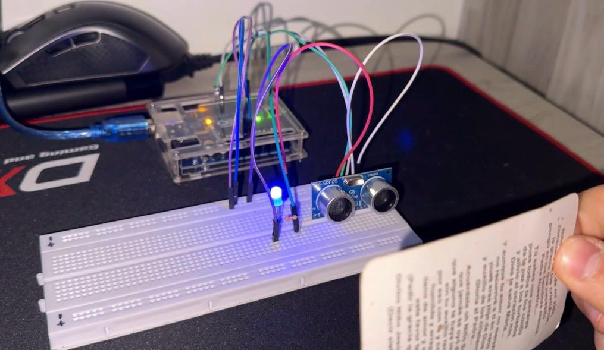 |

> En los laboratorios 5 y 6 se usaron sensores DHT11 y DHT22. El código está configurado para DHT22; para un DHT11 basta con cambiar el tipo de sensor en una línea.

---

## MultiBot

Carro de dos motores DC armado y programado por etapas con el shield **L298P** (puente H) y un receptor de radiofrecuencia **KRF100** de 4 botones.

| Etapa | Qué hace | Código | Foto |
| :-- | :-- | :-- | :-: |
| 1. Chasis | Armado del chasis, motores y ruedas | | 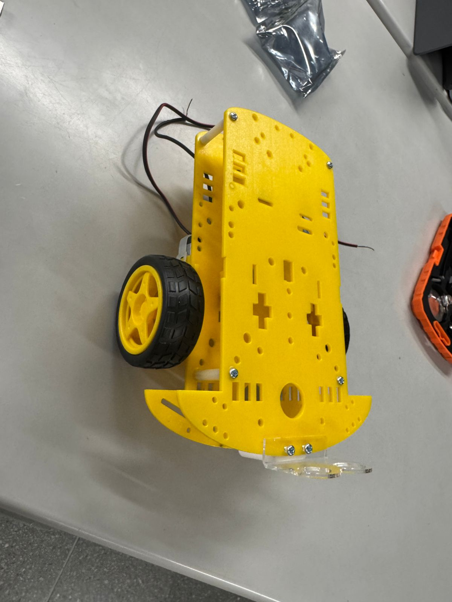 |
| 2. Puente H | Rutina automática: adelante, atrás, derecha e izquierda con velocidad por PWM | [puente-h.ino](multibot/2-puente-h/puente-h/puente-h.ino) | 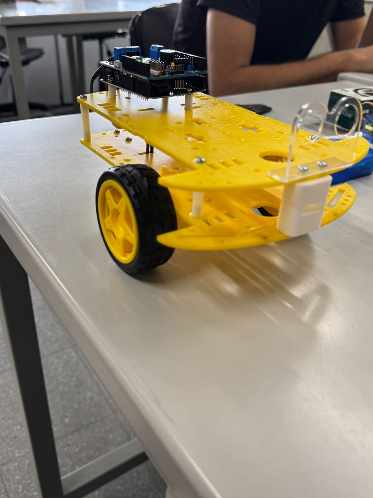 |
| 3. Control por radio | Manejo a distancia con los botones A, B, C y D del control | [control-por-radio.ino](multibot/3-control-por-radio/control-por-radio/control-por-radio.ino) | 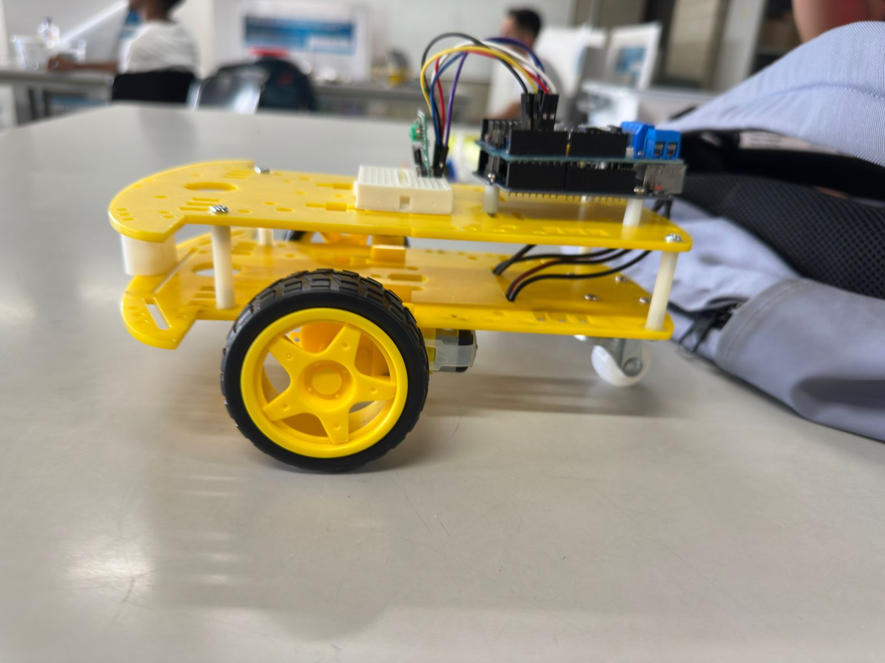 |
| 4. Velocidades ajustadas | Velocidad máxima en recta y menor en los giros para un control más estable | [velocidades-ajustadas.ino](multibot/4-velocidades-ajustadas/velocidades-ajustadas/velocidades-ajustadas.ino) | 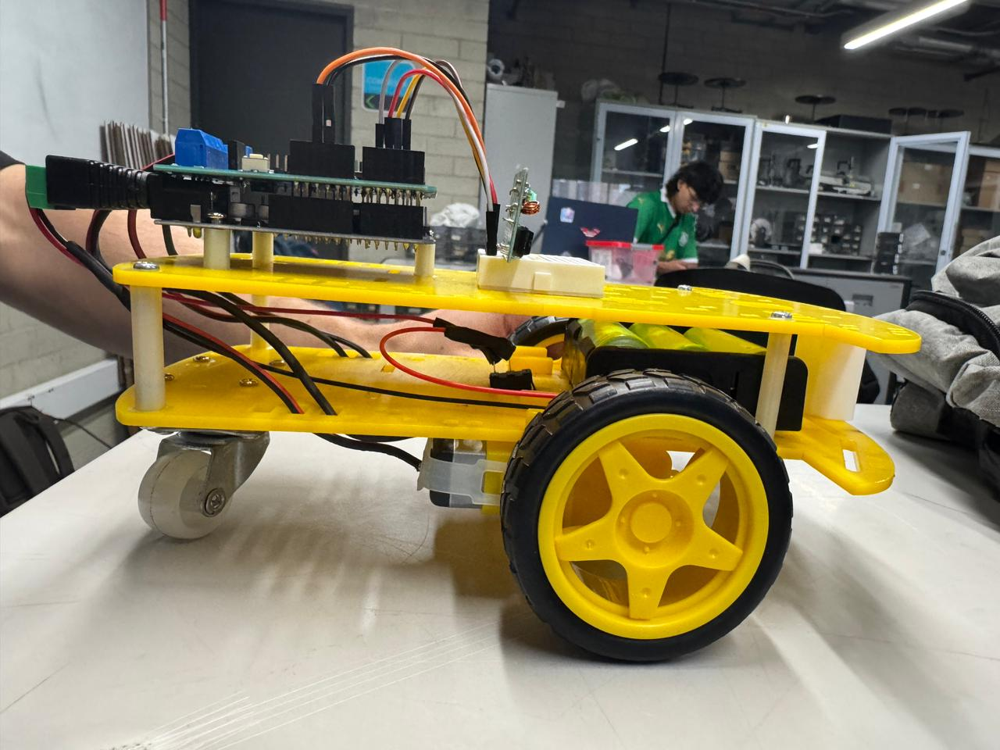 |

---

## Estructura

```
laboratorios/        7 laboratorios: código (.ino) y foto del montaje
multibot/            4 etapas del carro MultiBot
proyecto-final-rfid/ cerradura con RFID: código y presentación
```

## Cómo usarlo

1. Instala el [IDE de Arduino](https://www.arduino.cc/en/software).
2. Abre el archivo `.ino` de la carpeta que quieras.
3. Si el código usa librerías, instálalas desde **Herramientas → Administrar bibliotecas**:
   - Laboratorios 5 y 6: *DHT sensor library* y *Adafruit Unified Sensor*.
   - Laboratorio 6: *LiquidCrystal* (incluida en el IDE).
   - Proyecto final: *MFRC522*.
4. Selecciona la placa **Arduino UNO** y súbelo.

---

**Alexander Mejía Ospina** · [Portafolio](https://alexanderm-code.github.io/) · [LinkedIn](https://www.linkedin.com/in/alexander-mejia-ospina)
